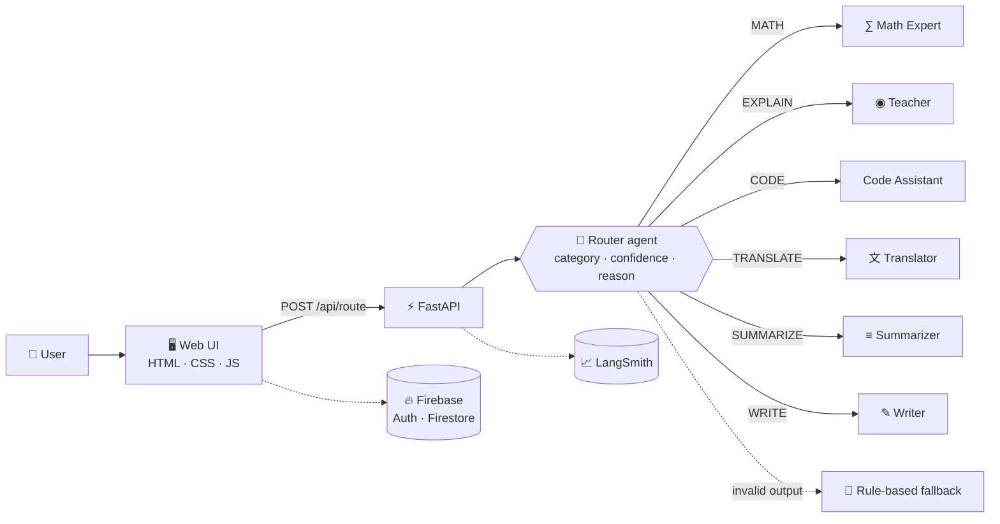
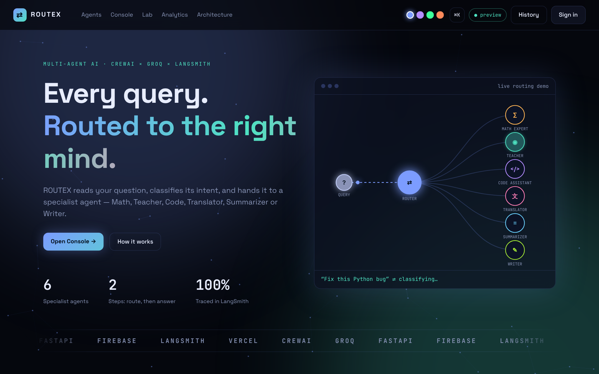
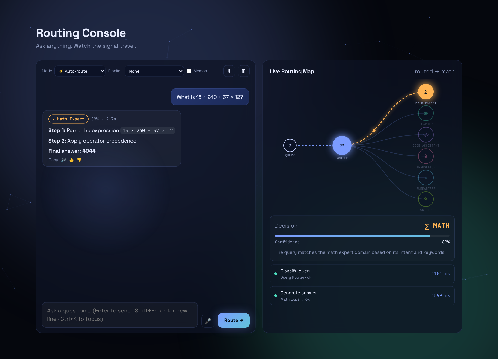
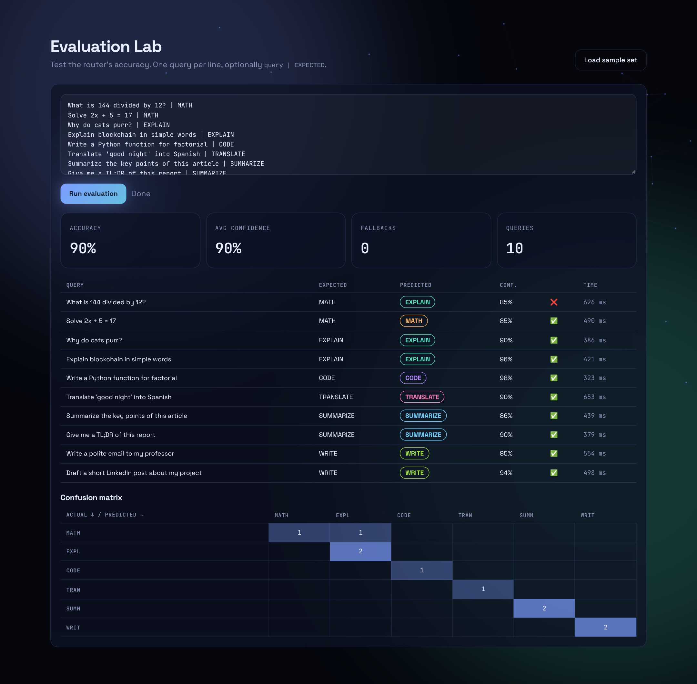
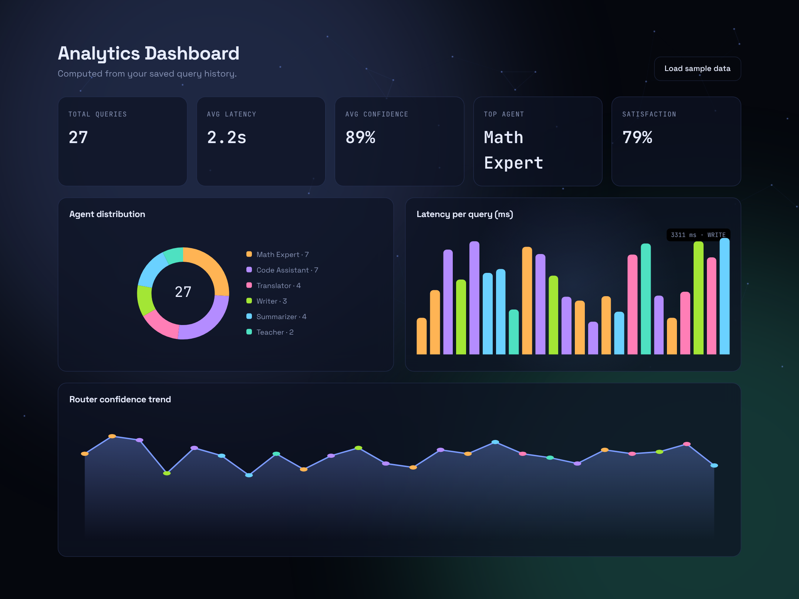

<div align="center">

# ⇄ ROUTEX

### Smart Query Router · Multi-Agent AI with CrewAI & Groq

*Every query, routed to the right mind.*

<br>


<br>

**[🚀 Live Demo](https://routex-ai-pro.vercel.app)** &nbsp;•&nbsp; **[📖 How it works](#-architecture)** &nbsp;•&nbsp; **[⚡ Quick start](#-quick-start-full-crewai-edition)** &nbsp;•&nbsp; **[🧪 Evaluation](#-evaluation)**

</div>

---

## 📌 Table of contents
- [Overview](#-overview) · [Architecture](#-architecture) · [Agents](#-meet-the-agents) · [Features](#-features)
- [Two editions](#-two-editions-full-crewai-vs-lite) · [Screenshots](#-screenshots) · [Project structure](#-project-structure)
- [Quick start](#-quick-start-full-crewai-edition) · [Environment variables](#-environment-variables) · [API](#-api-reference)
- [Evaluation](#-evaluation) · [Deployment](#-deployment) · [Troubleshooting](#-troubleshooting) · [Roadmap](#-roadmap) · [Author](#-author)

---

## 🎯 Overview

A single general-purpose prompt is rarely the best answer for every kind of request. A maths problem, a coding task and a translation each need a different role, tone and instructions.

**ROUTEX** is a Smart Query Router. A **Router agent** reads the user's query, classifies its intent (category, confidence and a short reason), and hands it to the **specialist agent** best suited to answer. If the model's output is ever invalid, a **rule-based fallback** keeps the system working.

Built as an assignment for **AI & Data Science at SMIT**: *"Smart Query Router Using CrewAI"*, then extended into a complete product with a live routing map, analytics, login, history, tracing and deployment.

> **Note:** the hosted demo runs **ROUTEX Lite** (direct Groq API calls, no CrewAI, same agents and prompts). The full **CrewAI** edition runs locally or in Docker. See [Two editions](#-two-editions-full-crewai-vs-lite).

---

## 🧭 Architecture



**Request flow**
1. The user types a query (optionally picks a manual agent, a pipeline, or turns memory on).
2. The browser calls `POST /api/route`.
3. The Router agent returns JSON: `{category, confidence, reasoning}`. It is parsed and validated; on failure the fallback classifier is used.
4. The chosen specialist produces the answer.
5. The API returns the answer plus a step-by-step trace with timings in milliseconds.
6. The UI animates the routing map, shows the decision card and saves the record to history.

---

## 🤖 Meet the agents

| Agent | Category | What it does |
|---|---|---|
| ∑ **Math Expert** | `MATH` | Solves calculations step by step and checks the answer |
| ◉ **Teacher** | `EXPLAIN` | Explains concepts with simple analogies |
| </> **Code Assistant** | `CODE` | Writes, debugs and explains clean code |
| 文 **Translator** | `TRANSLATE` | Translates while keeping tone and meaning |
| ≡ **Summarizer** | `SUMMARIZE` | Condenses long text into key points |
| ✎ **Writer** | `WRITE` | Drafts emails, essays and posts in the tone you ask for |

Every agent is defined by a **role**, a **goal** and a **backstory** (`backend/app/meta.py`).

---

## ✨ Features

**🧠 Routing and agents**
- Router agent with confidence score and reasoning
- 6 specialist agents, manual mode (skip the router)
- **Agent pipelines**: Summarize → Translate, Explain → Summarize, Write → Translate, Code → Explain
- **Conversation memory** (last 4 turns sent as context)
- Rule-based **fallback classifier**, with the real LLM error shown in the trace

**🖥️ Interface**
- **Live routing map** with animated signal, decision card and per-step timings
- Typewriter answers, text-to-speech, voice input, copy and 👍/👎 feedback
- Command palette (`Ctrl+K`), 4 colour themes, history search, CSV/JSON export
- **Evaluation Lab**: batch accuracy test with a confusion matrix
- **Analytics dashboard**: queries, latency, confidence, top agent, satisfaction

**☁️ Platform**
- Firebase Authentication (Google and email) and Firestore history
- LangSmith traces for the router and every specialist
- Vercel (serverless) and Firebase Hosting deployment, Docker for the full edition

---

## 🔀 Two editions: Full (CrewAI) vs Lite

CrewAI and its dependencies are too large for Vercel serverless (the bundle was about 945 MB), so the project ships two editions that share the same agents, prompts, API and UI.

| | **Full edition** | **ROUTEX Lite** |
|---|---|---|
| Folder | `backend/` | `lite/` |
| Agent engine | **CrewAI** (Agent, Task, Crew) | Direct Groq API calls (`httpx`) |
| Best for | Local development, Docker, assignment demo | Hosted demo on Vercel |
| Size | Large (CrewAI + LiteLLM) | Small (FastAPI + httpx) |
| UI label | `online` | `online · lite` |
| Routing, fallback, pipelines, memory, batch, LangSmith | ✅ | ✅ |

`python scripts/sync_lite.py` copies the shared files and the frontend into `lite/`.

---

## 🖼️ Screenshots

> Add your screenshots to `docs/screenshots/` and they will show up here.

| Landing | Console |
|---|---|
|  |  |

| Evaluation Lab | Analytics |
|---|---|
|  |  |

---

## 🗂️ Project structure

```text
routex-ai/
├── backend/app/               Full edition (CrewAI)
│   ├── main.py                FastAPI routes
│   ├── router_service.py      classify → specialist, chaining, memory
│   ├── agents.py              CrewAI agents + SafeLLM
│   ├── meta.py                agent roles, goals, backstories (no CrewAI import)
│   ├── compat.py              strips CrewAI's cache_breakpoint flag for Groq
│   ├── heuristics.py          rule-based fallback classifier
│   ├── tracing.py             LangSmith helper
│   └── config.py, schemas.py
├── lite/                      Lite edition (no CrewAI), deploy with Root Directory = lite
│   ├── api/                   one Vercel function per route (health, agents, classify, route, batch)
│   ├── app/                   FastAPI app + Groq client (service.py, llm.py)
│   ├── public/                static frontend served by Vercel
│   └── vercel.json, requirements.txt
├── frontend/                  Vanilla JS app (ES modules, SVG charts, no build step)
│   ├── index.html
│   ├── css/                   base · layout · components
│   └── js/                    main · chat · viz · analytics · lab · auth · store · firebase · api · config · ui
├── scripts/sync_lite.py       copies shared files and frontend into lite/
├── tests/                     unit tests + labelled evaluation set
├── Dockerfile                 full edition container (port 7860)
├── firebase.json  firestore.rules  render.yaml  vercel.json
└── requirements.txt  .env.example
```

---

## ⚡ Quick start (Full CrewAI edition)

**Requirements:** Python 3.10 to 3.13, a [Groq API key](https://console.groq.com), optionally a [LangSmith](https://smith.langchain.com) key.

```bash
# 1. Clone
git clone https://github.com/scientistayat-engineer/routex-ai.git
cd routex-ai

# 2. Virtual environment (Windows)
python -m venv .venv
.venv\Scripts\activate
# macOS / Linux:  source .venv/bin/activate

# 3. Install
pip install -r requirements.txt

# 4. Configure
copy .env.example .env      # macOS / Linux: cp .env.example .env
# then open .env and add GROQ_API_KEY (and optional LANGSMITH_* keys)

# 5. Run
uvicorn backend.app.main:app --reload --reload-dir backend --reload-dir frontend
```

Open **http://127.0.0.1:8000**. The pill in the header should read **● online**.

**Run the Lite edition locally**
```bash
cd lite
pip install -r requirements.txt
uvicorn app.main:app --reload
```

---

## 🔐 Environment variables

| Variable | Required | Example | Purpose |
|---|---|---|---|
| `GROQ_API_KEY` | ✅ | `gsk_...` | Groq API key |
| `GROQ_MODEL` | | `groq/openai/gpt-oss-120b` (full) · `openai/gpt-oss-120b` (Lite) | Model id |
| `LANGSMITH_TRACING` | | `true` | Enable tracing |
| `LANGSMITH_API_KEY` | | `lsv2_...` | LangSmith key |
| `LANGSMITH_PROJECT` | | `smart-query-router` | LangSmith project |
| `ALLOWED_ORIGINS` | | `*` | CORS origins |
| `MAX_QUERY_CHARS` | | `2000` | Max query length |

Never commit `.env`. It is already in `.gitignore`.

---

## 🔌 API reference

| Method | Path | Purpose |
|---|---|---|
| `GET` | `/api/health` | Status, engine (`crewai` or `lite`), model, key and tracing flags |
| `GET` | `/api/agents` | Router and the six specialist agents |
| `POST` | `/api/classify` | Instant rule-based intent hint (no LLM call) |
| `POST` | `/api/route` | Route and answer. Body: `query`, optional `force_agent`, `chain`, `memory` |
| `POST` | `/api/batch` | Classify up to 10 queries with the router (used by the Evaluation Lab) |

```bash
curl -X POST http://127.0.0.1:8000/api/route \
  -H "Content-Type: application/json" \
  -d '{"query": "What is 15 × 240 + 37 × 12?"}'
```

```json
{
  "category": "MATH",
  "confidence": 0.99,
  "reasoning": "The query asks for an arithmetic calculation.",
  "agent": { "key": "MATH", "role": "Math Expert" },
  "answer": "15 × 240 = 3600 ... Answer: 4044",
  "steps": [
    { "step": "Classify query", "agent": "Query Router", "status": "ok", "ms": 954 },
    { "step": "Generate answer", "agent": "Math Expert", "status": "ok", "ms": 3659 }
  ],
  "chain": [],
  "used_fallback": false
}
```

Pipeline example: `{"query": "...", "chain": ["SUMMARIZE", "TRANSLATE"]}`. Errors: `400` empty query, `413` too long, `500` server key missing.

---

## 🧪 Evaluation

```bash
pip install pytest
pytest                         # 11 tests (rule-based classifier + Lite service)
python tests/eval_fallback.py  # fallback accuracy on 36 labelled queries
```

**Rule-based fallback on 36 labelled queries (6 per category, including ambiguous phrasings):**

| Category | Correct | Total |
|---|---|---|
| MATH | 3 | 5 |
| EXPLAIN | 6 | 7 |
| CODE | 5 | 6 |
| TRANSLATE | 6 | 6 |
| SUMMARIZE | 4 | 6 |
| WRITE | 6 | 6 |
| **Overall** | **30** | **36 (83.3%)** |

Misses are phrasings without a known keyword ("divided by", "square root", "condense", "boil down") and "how do I calculate…" (an explanation request). These are the cases the LLM router is meant to handle.

To measure the **LLM router** on your own queries, open the **Evaluation Lab** in the UI, paste lines like `Solve 2x + 5 = 17 | MATH`, and press *Run evaluation* to get accuracy and a confusion matrix.

**LangSmith:** each request appears as `smart_query_router` with child runs `router_agent_classify` and `specialist_agent_answer` (`router_batch_item` for the Lab).

---

## 🚀 Deployment

### Vercel (ROUTEX Lite)
1. Import the repo in Vercel.
2. **Root Directory = `lite`**, **Framework Preset = Other**. Leave *Output Directory* override off.
3. Add environment variables: `GROQ_API_KEY`, `GROQ_MODEL=openai/gpt-oss-120b`, `LANGSMITH_TRACING=true`, `LANGSMITH_API_KEY`, `LANGSMITH_PROJECT=smart-query-router`.
4. Deploy, then open `/api/health`. It should show `"engine":"lite"` and `"groq_key_set":true`.

### Firebase (Auth, Firestore, Hosting)
1. Create a Firebase project, add a **Web app**, and paste its config into `frontend/js/config.js`.
2. Enable **Authentication** (Google and Email/Password) and **Firestore**.
3. Set `API_BASE` in `frontend/js/config.js` to your Vercel URL, then:
   ```bash
   firebase deploy --only firestore:rules,hosting
   ```
4. Add the Vercel domain under *Authentication → Settings → Authorized domains*.

### Docker (full edition)
```bash
docker build -t routex .
docker run -p 7860:7860 --env-file .env routex
```

---

## 🛠️ Troubleshooting

| Problem | Fix |
|---|---|
| `'cache_breakpoint' is unsupported` from Groq | Newer CrewAI versions add that flag. `backend/app/compat.py` strips it. Make sure the file exists and the server was restarted. |
| `LAMBDA_SIZE_EXCEEDED` on Vercel | CrewAI is too large for serverless. Deploy the **Lite** edition (Root Directory = `lite`). |
| `{"detail":"Not Found"}` on the Vercel root | Frontend must be in `lite/public`, and the *Output Directory* override must be off. |
| Page loads forever on `127.0.0.1:8000` | Another server may be using the port. Run uvicorn with `--port 8010`. |
| `ERR_NAME_NOT_RESOLVED` in the browser console | A DNS problem on your network. Try DNS `8.8.8.8` or another network. |
| Pill says `key missing` | `GROQ_API_KEY` is not set on the server. |

---

## 🗺️ Roadmap

- [x] Router + 6 specialist agents, fallback classifier
- [x] Pipelines, conversation memory, Evaluation Lab
- [x] Live routing map, analytics, themes, command palette
- [x] Firebase auth + history, LangSmith tracing
- [x] Vercel (Lite) and Firebase deployment
- [ ] PDF / file upload with retrieval (RAG)
- [ ] Admin panel, rate limiting and usage limits
- [ ] Urdu interface and light theme
- [ ] Streaming responses and query caching
- [ ] Router-proposed multi-step plans

---

## 👩‍💻 Author

**Anushay Ayat** · AI & Data Science, **SMIT**
GitHub: [@scientistayat-engineer](https://github.com/scientistayat-engineer)

Built with CrewAI, Groq, FastAPI, Firebase, LangSmith and Vercel.

<div align="center">

⭐ If you like this project, give it a star!

</div>